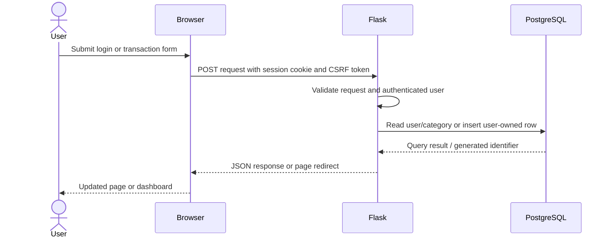

# Personal Finance Analytics — DBMS Project Report

## 1. Project Title

**Personal Finance Analytics**

## 2. Team Members


 Don Arun   cb.sc.u4aie24016  
Meghana K V cb.sc.u4aie24022  
Supriya K   cb.sc.u4aie24025  
 Shivanandana A cb.sc.u4aie24049
## 3. Introduction and Problem Statement

We built a web application for recording personal transactions and reviewing spending against monthly budgets. Users can register and log in, set an overall and category budget, import transaction history from a CSV, and add daily expense transactions. The dashboard displays current-month spending, category spending, recent transactions, budget alerts, and available forecasts.

Manual transaction records become difficult to summarize consistently as data grows. We use PostgreSQL to store users, transactions, lookup values, budgets, and forecast records in related tables. Flask provides the application routes and database access; the browser interface is served by Flask and uses HTML, CSS, and JavaScript.

The current app records expenses from its manual-entry form. The database supports income transactions too, but the form's insert statement writes `Expense`. 


## 4. Architecture and Database Design

### 4.1 Architecture

Preprocessing: Clean and standardize transaction data, extract relevant features, and create time-series sequences. 
LSTM (overall and category wise): Forecast future spending using historical time-series data. 
Rule Based System: Detect anomalous spending patterns. 
Datasets: Two datasets, initial one had data issues and performed poorly for all baselines.
RNN, CNN, Seasonal Naives, XGBoost : Baseline models 
Python: Data preprocessing, model training, and backend/ML integration. 
PostgreSQL: Store users, transactions, budgets, predictions, alerts, and related data. 
React: Frontend/dashboard for user interaction and visualization. 
Flask: Backend REST APIs connecting the frontend, database, and ML models. 
Docker: Containerize the application for deployment. 
Azure: Cloud deployment and hosting.

The application is containerized with Docker Compose. The Compose file defines a PostgreSQL 16 database and a Flask/Gunicorn application. The app connects to PostgreSQL using the Compose service hostname `db`. Compose currently publishes host ports using `HOST_DB_PORT` and `APP_PORT`.

The app uses Flask's signed browser session cookie for login state. Passwords are stored as password hashes. The `user_sessions` table exists in the schema, but Flask's current login flow does not persist its session there.

Tracing the SQL in backend/app.py, the normal account, onboarding, and dashboard flows read or write users, user_preferences, categories, payment_modes, locations, transactions, budgets, model_registry, alerts, recurring_payments, and predictions. Account deletion touches some analytics/goal tables for cleanup. 

### 4.2 Conceptual and Logical Design

The core entities are users, transactions, categories, budgets, and user preferences. Transactions reference category and optional payment-mode, location, account, and upload records. Forecasts reference a user and model registry entry; optional alert records can reference a forecast. The remaining analytics and goal entities store rollups or planned application data.

 The `transactions` to `accounts` and `statement_uploads` relationships are composite `(id, user_id)` foreign keys, enforcing that a linked account or upload belongs to the same user. `predictions.category_id` is nullable but the migration does not declare it as a foreign key to `categories`.

### 4.3 Application Data Flow



For manual transaction entry, the route resolves the submitted category name, then inserts the row with the `user_id` from the authenticated session. It does not trust a user ID supplied by the browser. CSV onboarding similarly maps category and optional lookup names, ignores the CSV's user ID, validates rows, and assigns the authenticated account as owner.

### 4.4 Relational Schema and Table Structures

The definitions below reflect migrations `001_users.sql` through `005_app_auth_and_predictions.sql`. `PK` means primary key, `FK` means foreign key, `UQ` means unique, and `NULL` means nullable. Defaults and checks are included where they affect behavior.

#### Identity and preferences

| Table | Attributes and keys |
|---|---|
| `users` | `user_id VARCHAR(10)` PK; `name VARCHAR(100)` NOT NULL; `email VARCHAR(100)` UNIQUE NOT NULL; `password_hash TEXT` NOT NULL; `phone VARCHAR(15)` NULL; `created_at TIMESTAMP` default current time; `username VARCHAR(64)` NOT NULL, added in migration 005 and uniquely indexed on `LOWER(username)`. |
| `user_sessions` | `session_id SERIAL` PK; `user_id VARCHAR(10)` FK → `users`, ON DELETE CASCADE; `token TEXT` NOT NULL; `device_info VARCHAR(100)` NULL; `expires_at TIMESTAMP` NOT NULL. |
| `user_preferences` | `preference_id SERIAL` PK; `user_id VARCHAR(10)` UNIQUE NOT NULL FK → `users`, ON DELETE CASCADE; `monthly_income DECIMAL(12,2)` NULL; `monthly_budget DECIMAL(12,2)` NULL; `currency VARCHAR(10)` default `INR`; `notify_email BOOLEAN` and `notify_push BOOLEAN` default TRUE. |

#### Transaction domain

| Table | Attributes and keys |
|---|---|
| `categories` | `category_id SERIAL` PK; `category_name VARCHAR(50)` UNIQUE NOT NULL. Migration 002 inserts the category lookup values. |
| `payment_modes` | `payment_mode_id SERIAL` PK; `mode_name VARCHAR(30)` UNIQUE NOT NULL. Migration 002 inserts lookup values. |
| `locations` | `location_id SERIAL` PK; `location_name VARCHAR(100)` UNIQUE NOT NULL. Migration 002 inserts lookup values. |
| `accounts` | `account_id SERIAL` PK; `user_id VARCHAR(10)` FK → `users`, ON DELETE CASCADE; `bank_name VARCHAR(100)` NOT NULL; `account_type VARCHAR(30)` NOT NULL, checked against `Savings`, `Current`, `Credit`, `Other`; UQ (`account_id`, `user_id`) supports the transaction composite FK. |
| `statement_uploads` | `upload_id SERIAL` PK; `user_id VARCHAR(10)` FK → `users`, ON DELETE CASCADE; `blob_url TEXT` NOT NULL; `file_name VARCHAR(255)` NULL; `file_type VARCHAR(10)` NULL, checked against `csv`/`pdf`; `status VARCHAR(20)` default `pending`, checked against `pending`/`processed`/`failed`; `uploaded_at TIMESTAMP` default current time; `processed_at TIMESTAMP` NULL; UQ (`upload_id`, `user_id`). |
| `transactions` | `transaction_id SERIAL` PK; `source_transaction_id VARCHAR(20)` NULL; `user_id VARCHAR(10)` NOT NULL FK → `users`, ON DELETE CASCADE; `account_id INTEGER` NULL composite FK → `accounts(account_id,user_id)`, clears `account_id` on delete; `category_id INTEGER` NOT NULL FK → `categories`; `payment_mode_id INTEGER` NULL FK → `payment_modes`; `location_id INTEGER` NULL FK → `locations`; `amount NUMERIC(12,2)` NOT NULL and > 0; `transaction_type VARCHAR(10)` NOT NULL, checked to `Expense`/`Income`; `transaction_date DATE` NOT NULL; `description TEXT` NULL; `source VARCHAR(10)` default `manual`, checked to `manual`/`csv`/`pdf`; `upload_id INTEGER` NULL composite FK → `statement_uploads(upload_id,user_id)`, clears `upload_id` on delete. |
| `budgets` | `budget_id SERIAL` PK; `user_id VARCHAR(10)` FK → `users`, ON DELETE CASCADE; `category_id INTEGER` FK → `categories`; `month DATE` must be the first day of the month; `budget_amount NUMERIC(12,2)` >= 0; UQ (`user_id`, `category_id`, `month`). |
| `recurring_payments` | `recurring_id SERIAL` PK; `user_id VARCHAR(10)` FK → `users`, ON DELETE CASCADE; `category_id INTEGER` FK → `categories`; `amount NUMERIC(12,2)` > 0; `frequency VARCHAR(20)` checked to `daily`/`weekly`/`monthly`/`quarterly`/`yearly`; `next_due_date DATE` NOT NULL; `description TEXT` NULL; `is_active BOOLEAN` default TRUE. |
| `goals` | `goal_id SERIAL` PK; `user_id VARCHAR(10)` FK → `users`, ON DELETE CASCADE; `goal_name VARCHAR(100)` NOT NULL; `target_amount NUMERIC(12,2)` > 0; `current_amount NUMERIC(12,2)` default 0 and >= 0 and <= target; `target_date DATE` NULL; `created_at TIMESTAMP` default current time. |

#### Analytics and model records

| Table | Attributes and keys |
|---|---|
| `monthly_summary` | Composite PK (`user_id`, `month`); `user_id VARCHAR(10)` FK → `users`; `month DATE` NOT NULL; `total_income NUMERIC(12,2)` and `total_expense NUMERIC(12,2)` default 0; `savings_rate NUMERIC(5,2)` NULL; `updated_at TIMESTAMP` default now. |
| `category_monthly_summary` | Composite PK (`user_id`, `category_id`, `month`); `user_id VARCHAR(10)` FK → `users`; `category_id INTEGER` FK → `categories`; `month DATE` NOT NULL; `total_spent NUMERIC(12,2)` default 0; `txn_count INTEGER` default 0; `updated_at TIMESTAMP` default now. |
| `detected_recurring_payments` | `recurring_id SERIAL` PK; `user_id VARCHAR(10)` FK → `users`; `category_id INTEGER` FK → `categories`; `amount_estimate NUMERIC(12,2)` NULL; `frequency VARCHAR(20)` NULL; `months_seen INTEGER` NULL; `last_detected_at TIMESTAMP` default now. |
| `goal_progress` | Composite PK (`goal_id`, `as_of_month`); `goal_id INTEGER` FK → `goals`; `as_of_month DATE` NOT NULL; `current_amount NUMERIC(12,2)` default 0; `progress_pct NUMERIC(5,2)` NULL; `updated_at TIMESTAMP` default now. |
| `model_registry` | `model_id SERIAL` PK; `model_name VARCHAR(100)` NOT NULL; `model_type VARCHAR(50)` NOT NULL; `blob_storage_path TEXT` NULL; `trained_at TIMESTAMP` default current time; `metrics_json JSONB` NULL. |
| `predictions` | `prediction_id SERIAL` PK; `user_id VARCHAR(10)` NOT NULL FK → `users`, ON DELETE CASCADE; `model_id INTEGER` NOT NULL FK → `model_registry`; `prediction_type VARCHAR(50)` NOT NULL; `category_id INTEGER` NULL (no FK declared); `target_period DATE` NOT NULL; `predicted_value DECIMAL(12,2)` NOT NULL; `generated_at TIMESTAMPTZ` NOT NULL default now, added in migration 005. |
| `anomalies` | `anomaly_id SERIAL` PK; `transaction_id INTEGER` NOT NULL FK → `transactions`, ON DELETE CASCADE; `model_id INTEGER` NOT NULL FK → `model_registry`; `reconstruction_error DECIMAL(12,6)` NOT NULL; `is_anomaly BOOLEAN` NOT NULL default FALSE. |
| `alerts` | `alert_id SERIAL` PK; `user_id VARCHAR(10)` NOT NULL FK → `users`, ON DELETE CASCADE; `alert_type VARCHAR(50)` NOT NULL; `message TEXT` NOT NULL; `related_prediction_id INTEGER` NULL FK → `predictions`, ON DELETE SET NULL; `severity VARCHAR(20)` NOT NULL default `medium`. |
| `notifications` | `notification_id SERIAL` PK; `alert_id INTEGER` NOT NULL FK → `alerts`, ON DELETE CASCADE; `channel VARCHAR(20)` NOT NULL; `sent_at TIMESTAMP` NULL; `read_at TIMESTAMP` NULL. |

Migration 003 creates indexes on user/month summary lookup keys and goal progress; migration 005 adds the case-insensitive username index and an index on (`predictions.user_id`, `generated_at DESC`).

### 4.5 Sample Records

The rows below are **illustrative synthetic examples**, not copied from the database or a real user's data. Identifiers are only examples; generated numeric IDs will differ.

| Table | Illustrative row |
|---|---|
| `users` | `('U000000001', 'Demo User', 'demo@example.test', '<Werkzeug password hash>', NULL, CURRENT_TIMESTAMP, 'demo-user')` |
| `categories` | `(5, 'Food')` |
| `user_preferences` | `(1, 'U000000001', NULL, 20000.00, 'INR', TRUE, TRUE)` |
| `transactions` | `(1, 'T-DEMO-001', 'U000000001', NULL, 5, NULL, NULL, 250.00, 'Expense', '2026-01-10', 'Lunch', 'manual', NULL)` |
| `budgets` | `(1, 'U000000001', 5, '2026-01-01', 5000.00)` |
| `model_registry` | `(1, 'Category seven-day LSTM', 'LSTM_CATEGORY', '<local model path>', CURRENT_TIMESTAMP, NULL)` |
| `predictions` | `(1, 'U000000001', 1, 'category_daily', 5, '2026-01-11', 275.00, CURRENT_TIMESTAMP)` |

The optional `dbms/seed/sample_data.sql` script is not part of app startup. It expects `preprocessing/processed/standardised_dataset.csv`, which isn’t necessary for the actual app. It also synthesizes placeholder user names, emails, and password hashes, so those rows are for development/demo use only. 

## 5. Normalization and Functional Dependencies

### 5.1 Normalization

The schema separates user, category, payment-mode, location, account, and transaction data. This avoids repeating descriptive lookup values in each transaction and lets foreign keys enforce references. Budgets are separated from transactions and have a uniqueness rule for each user/category/month. Preferences are separated into one row per user. Forecast results are separated from model metadata.

The base entity tables use primary keys, and their ordinary attributes depend on those keys. Lookup values are stored once and referenced by ID. The design therefore follows the common goals of 1NF, 2NF, and 3NF for these relations, with these qualifications:

- `metrics_json` is intentionally semi-structured JSONB.
- Analytics summary and goal-progress tables are derived snapshots/rollups, so they duplicate values that could be recomputed from source tables.
- The schema does not declare every possible business rule (for example, that each `month` in summary tables is the first day of a month).
- The database currently defines tables that the Flask app does not yet maintain. Their consistency depends on future application logic.

### 5.2 Functional Dependencies

Representative dependencies implied by declared primary and unique keys:

- `user_id -> name, email, password_hash, phone, created_at, username`
- `LOWER(username) -> user_id` (unique case-insensitive index)
- `email -> user_id` and the other user attributes (unique email)
- `preference_id -> user_id, monthly_income, monthly_budget, currency, notify_email, notify_push`; `user_id` is also unique in `user_preferences`.
- `category_id -> category_name`; `payment_mode_id -> mode_name`; `location_id -> location_name`
- `account_id -> user_id, bank_name, account_type`
- `transaction_id -> source_transaction_id, user_id, account_id, category_id, payment_mode_id, location_id, amount, transaction_type, transaction_date, description, source, upload_id`
- `(user_id, category_id, month) -> budget_amount`
- `(user_id, month) -> total_income, total_expense, savings_rate, updated_at`
- `(user_id, category_id, month) -> total_spent, txn_count, updated_at`
- `(goal_id, as_of_month) -> current_amount, progress_pct, updated_at`
- `prediction_id -> user_id, model_id, prediction_type, category_id, target_period, predicted_value, generated_at`

These dependencies describe the keys in the migrations; they do not mean every listed table is actively populated by the current app.

## 6. Advanced SQL Implementation and Query Design

The application uses parameterized PostgreSQL queries, joins, aggregate functions, grouping, upserts, generated identifiers, and date-bounded filters. The examples below are adapted from SQL statements actually used in `backend/app.py`; parameter placeholders and selected columns are retained to show their purpose.

### 6.1 Dashboard category spending

```sql
SELECT c.category_name AS category, SUM(t.amount) AS amount
FROM transactions t
JOIN categories c ON c.category_id = t.category_id
WHERE t.user_id = %s
  AND t.transaction_type = 'Expense'
  AND t.transaction_date >= %s
  AND t.transaction_date <= %s
GROUP BY c.category_name
ORDER BY amount DESC;
```

**Purpose:** This is the dashboard's pie-chart query. It joins normalized category labels to transactions, filters the current user and the six-calendar-month date range, and aggregates expense amounts per category.

### 6.2 Dashboard category budgets

```sql
SELECT b.budget_amount, c.category_id, c.category_name AS category
FROM budgets b
JOIN categories c ON c.category_id = b.category_id
WHERE b.user_id = %s AND b.month = %s;
```

**Purpose:** Retrieves only the authenticated user's category budgets for the selected month. The dashboard combines these results with the user's transaction totals in application logic.

### 6.3 Onboarding upsert

```sql
INSERT INTO budgets (user_id, category_id, month, budget_amount)
VALUES (%s, %s, %s, %s)
ON CONFLICT (user_id, category_id, month)
DO UPDATE SET budget_amount = EXCLUDED.budget_amount;
```

**Purpose:** Creates a category budget or updates the existing budget for the same user, category, and month. The unique constraint on those columns makes the upsert deterministic.


## 7. ER Diagram and UML Diagram

The ER and UML diagrams are included in the project report.

## 8. Conclusion and Future Scope

We implemented a relational PostgreSQL foundation for user accounts, transaction capture, lookup data, budgets, analytics records, and model outputs. The app already supports account registration/login, onboarding, CSV transaction import, manual expense entry, dashboard aggregation, and stored forecast rows.

Future database work could add explicit migration management for existing databases, enforce month/date rules consistently, and wire the unused goals, recurring-payment, upload-metadata, and notification tables to application flows. The repository does not establish a completed Azure deployment, managed database, or external file-storage service.
