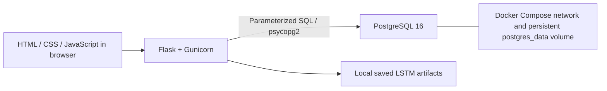
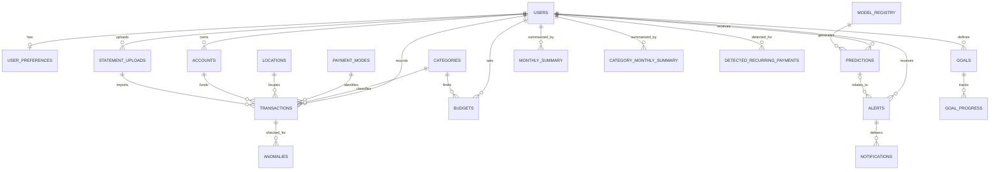
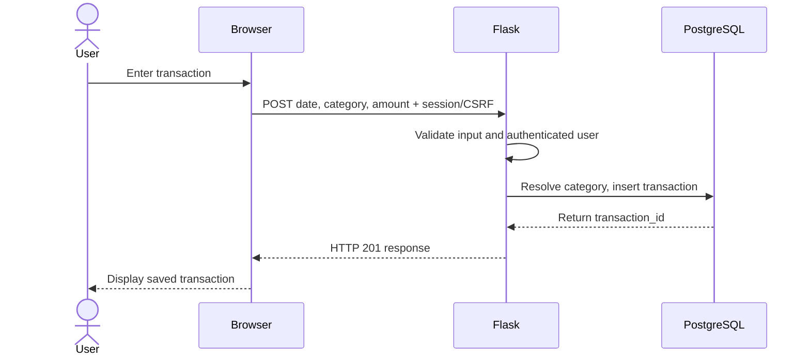

# Personal Finance Analytics

## Project Title and Team

**Project:** Personal Finance Analytics  

**Team members:**  
 Don Arun   cb.sc.u4aie24016  
Meghana K V cb.sc.u4aie24022  
Supriya K   cb.sc.u4aie24025  
 Shivanandana A cb.sc.u4aie24049

## Project Overview, Introduction, and Problem Statement

We built a Flask web application that stores personal transactions in PostgreSQL and presents spending and budget analytics. Users can register, log in, define an overall monthly budget and category budgets, upload a CSV history during onboarding, and enter daily expenses. The dashboard shows actual spending, category charts, recent transactions, budget alerts, and forecasts when the required model history and artifacts are available.

The database provides durable, relational storage for user-owned transactions and related budget and lookup data. The current application focuses on expense entry and analysis; although the schema supports income, goals, recurring payments, and other records, not all of those schema areas have application workflows yet.

## System Requirements and Architecture

### Requirements

- Docker with Docker Compose for the documented containerized run.
- A browser for registration and dashboard use.
- Python 3.11 and the packages in `backend/requirements.txt` only if running Flask directly on the host.
- PostgreSQL 16 is configured in Compose. The application container connects to the `db` service.
- A local `.env` file based on `.env.example` with a non-placeholder `DB_PASSWORD` and `SECRET_KEY`.

### Architecture



The frontend is served by Flask. Authentication uses a signed Flask session cookie; user-owned database queries use the `user_id` stored in that session. Passwords are saved as Werkzeug hashes. Model inference uses saved local artifacts; training is not part of normal app startup.

The current Compose file maps host ports using `HOST_DB_PORT` and `APP_PORT`. PostgreSQL does not need an externally reachable port for the app-to-database connection, which uses the internal Compose hostname `db`; however, this repository's current Compose configuration does publish the database port on the host. Treat that as a local-development configuration, not a production Azure network policy. The project does not contain a verified Azure deployment.

## Conceptual Database Design, ER Diagram, and UML

The core database entities are users, transactions, categories, user preferences, and budgets. Transactions can also reference payment mode, location, account, and statement-upload rows. Forecasts reference a user and a model registry entry; alerts and notifications have their own foreign-key relationships.



This diagram follows foreign keys in migrations 001-005. The complete table list and all declared key details are in [`project_report.md`](./project_report.md), Section 4.4. In particular, transactions use composite foreign keys to ensure linked accounts and uploads belong to the same user; `predictions.category_id` has no category foreign key in the current migration.

The UML-style sequence below describes the implemented manual transaction path:



These diagrams are based on migration foreign keys and the transaction route.    

## Relational Schema Mapping

The migrations create these 21 tables:

| Group | Tables |
|---|---|
| Identity | `users`, `user_sessions`, `user_preferences` |
| Transaction and budgeting | `categories`, `payment_modes`, `locations`, `accounts`, `statement_uploads`, `transactions`, `budgets`, `recurring_payments`, `goals` |
| Analytics | `monthly_summary`, `category_monthly_summary`, `detected_recurring_payments`, `goal_progress` |
| Model and notifications | `model_registry`, `predictions`, `anomalies`, `alerts`, `notifications` |

The primary relationships are `users -> transactions`, `users -> budgets`, `transactions -> categories`, `transactions -> payment_modes`, `transactions -> locations`, and `model_registry -> predictions`. See the report's table-by-table schema for columns, types, primary/foreign keys, checks, and delete behavior. Migrations 001 through 005 are the schema source.

## Normalization and Functional Dependencies

We keep lookup names in separate category, payment-mode, and location tables and reference them by IDs. User preferences, budgets, transactions, models, and predictions have separate relations. This reduces repeated descriptive data and lets database constraints validate references.

Representative functional dependencies include:

- `user_id -> name, email, password_hash, phone, created_at, username`
- `category_id -> category_name`
- `transaction_id -> user_id, category_id, amount, transaction_type, transaction_date, description, source`
- `(user_id, category_id, month) -> budget_amount`
- `(user_id, month) -> total_income, total_expense, savings_rate`
- `prediction_id -> user_id, model_id, prediction_type, category_id, target_period, predicted_value`

The schema is designed around normalized base entities, with deliberate exceptions for JSONB model metrics and derived summary tables. Summary tables duplicate values that can be recomputed. Full qualifications and additional dependencies are in the report's normalization section.

## Methodology and Database Design

1. PostgreSQL migrations define tables, keys, constraints, and lookup seed values.
2. Registration stores a password hash and starts a signed browser session.
3. Onboarding stores the overall preference and category/month budgets; optional CSV rows are validated and assigned to the signed-in user.
4. Manual entry resolves the category name and inserts an `Expense` transaction for the signed-in user.
5. The dashboard queries only that user's transactions and budgets, groups expenses by category, and invokes inference using saved model artifacts.
6. When model output is available, the app stores forecast rows in `predictions` and model metadata in `model_registry`.

Tracing `backend/app.py`, normal account/onboarding/dashboard workflows read or write `users`, `user_preferences`, `categories`, `payment_modes`, `locations`, `transactions`, `budgets`, `model_registry`, and `predictions`. Other schema tables are not populated by those workflows: `user_sessions`, `accounts`, `statement_uploads`, `recurring_payments`, `goals`, `monthly_summary`, `category_monthly_summary`, `detected_recurring_payments`, `goal_progress`, `anomalies`, `alerts`, and `notifications`. Account deletion accesses some analytics/goal tables for cleanup. Dashboard alerts are computed in application code and returned by the API, not stored in `alerts`. CSV onboarding inserts transactions with `source='csv'`; it currently does not create a `statement_uploads` row. The app uses Flask session cookies rather than storing login sessions in `user_sessions`.

## Advanced SQL Queries and Purpose

The application uses parameterized queries, joins, `SUM`/`GROUP BY` aggregation, and `ON CONFLICT` upserts. The following examples are adapted from SQL actually executed by `backend/app.py`.

### Dashboard category spending

```sql
SELECT c.category_name AS category, SUM(t.amount) AS amount
FROM transactions t
JOIN categories c ON c.category_id = t.category_id
WHERE t.user_id = %s
  AND t.transaction_type = 'Expense'
  AND t.transaction_date >= %s
  AND t.transaction_date <= %s
GROUP BY c.category_name
ORDER BY amount DESC;
```

**Purpose:** Joins category names to the authenticated user's expenses and totals them over the date range used for the category pie chart.

### Upsert a category budget during onboarding

```sql
INSERT INTO budgets (user_id, category_id, month, budget_amount)
VALUES (%s, %s, %s, %s)
ON CONFLICT (user_id, category_id, month)
DO UPDATE SET budget_amount = EXCLUDED.budget_amount;
```

**Purpose:** Inserts a budget or updates the existing row for that user/category/month, using the schema's unique constraint.

The live query set demonstrates joins, aggregation, filters, and upserts. 

## Installation, Database Creation, and Execution

Run commands from the `Personal_Finance` directory in PowerShell.

### 1. Configure local environment

```powershell
Copy-Item .env.example .env
```

Edit `.env` and replace placeholder values for `DB_PASSWORD` and `SECRET_KEY`. Do not commit `.env` or include its values in screenshots. The checked-in `.env.example` uses `DB_HOST=localhost` for host-run development; Compose overrides the app's DB host to `db`.

### 2. Build and start app and database

```powershell
docker compose up --build -d
docker compose ps
Invoke-RestMethod http://localhost:8000/api/health
```

On an empty PostgreSQL data volume, the official Postgres image applies `dbms/migrations/001_users.sql` through `005_app_auth_and_predictions.sql` in filename order. The `postgres_data` named volume retains database data across container recreation. Migrations in the initialization directory are not automatically re-run against an existing initialized volume. Do not use `docker compose down -v` when preserving data.

To check the rendered configuration before starting:

```powershell
docker compose config
```

The `HOST_DB_PORT` setting defaults to 5432 and can conflict with a service already using that host port. The app connects to Postgres using the internal Compose network, not the host-published port.

### 3. Create and populate demonstration data

For the simplest reproducible app demo:

1. Open http://localhost:8000/register and create a demo account.
2. Complete onboarding with an overall budget and optional category budgets.
3. Optionally upload a valid CSV. Required columns are a date (`date`, `txn_date`, or `transaction_date`), category, and positive numeric amount. The app ignores an imported `user_id` and uses the logged-in account.
4. Add transactions from the dashboard and verify the category chart and recent transactions.

The optional SQL dataset loader in `dbms/seed/sample_data.sql` is not a working population command for the current schema: it expects `preprocessing/processed/standardised_dataset.csv`, which is not present at the documented path, and it omits `username`, which migration 005 makes NOT NULL. Do not run it against the current 001-005 schema as-is. To make this path reproducible, the team must first update the seed SQL to supply a unique username and provide the expected dataset. It also creates placeholder demo credentials, so it must not be used for production accounts.

### 4. Running Flask directly (optional)

Install `backend/requirements.txt` in Python 3.11 and set the DB environment variables from `.env`. For host-run Flask, use `DB_HOST=localhost` and `DB_PORT` equal to the published `HOST_DB_PORT`, then run:

```powershell
python -m backend.app
```

The Docker Compose app is the recommended reproduction path in this repository. Do not run model training scripts just to start the application.

## Tests and Validation

The checked-in backend tests are in `backend/test_app.py`. Database-facing route tests use mocked connections rather than a live PostgreSQL instance. Run them from `Personal_Finance`:

```powershell
python -m unittest discover -s backend -p "test_*.py" -v
```

The suite covers login/authentication behavior, CSRF enforcement, account deletion query construction, registration password hashing, CSV validation and ownership, and category inference input/output behavior. No test execution result is claimed in this document; run the command in the target environment and include its actual output in the submission.

Additional container checks:

```powershell
docker compose config
docker compose build app
docker compose up -d
Invoke-RestMethod http://localhost:8000/api/health
```

The health endpoint should return a connected status and database name. This is a runtime check for the local Compose setup, not evidence of cloud deployment.

## Demonstration Instructions and Reproducing Results

1. Start the Compose services using the commands above.
2. Confirm `docker compose ps` reports the app and database running and check `/api/health`.
3. Register a new demo account and complete onboarding with a monthly budget and at least one category budget.
4. Add several dated expense transactions across at least two categories. Optionally upload a valid CSV to demonstrate import.
5. Refresh the dashboard. Verify actual spending, pie-chart category totals, budget comparison, alerts, and recent transactions.
6. If forecasts are shown, note that inference depends on eligible user history and saved model/scaler artifacts. Do not represent unavailable forecast values as zero or as verified results.
7. To demonstrate database persistence, recreate the app container without deleting the named volume and log in again. Do not run `docker compose down -v`.
8. Capture screenshots of registration, onboarding, transaction entry, the populated dashboard, and the health check. No actual runtime screenshots are included in these documents.

For a DBMS review, include anonymized SQL output showing row counts or a category/month aggregate. Use only the dedicated demo account and synthetic or approved test data; do not expose credentials, password hashes, or real user transactions.

## Sample Outputs and Submission Items

- Health check: expected JSON shape is `{"status":"connected","database":"<configured database name>"}`. This is the response shape in the Flask route; record the actual value observed during the demo.
- Dashboard: record actual results from the live demo. Forecast availability and metric values depend on the user's data and model artifacts and should not be invented in this document.
- Add the team's names and IDs, actual screenshots, and sanitized demonstration output before final submission.

## Conclusion and Future Scope

We have a relational PostgreSQL schema and a running local web application for account-based transaction entry, budgets, and analytics. The schema also lays groundwork for goals, recurring payments, and notifications, though those areas need application flows and validation before they can be presented as completed features. Cloud deployment is not configured or verified by this project state.
